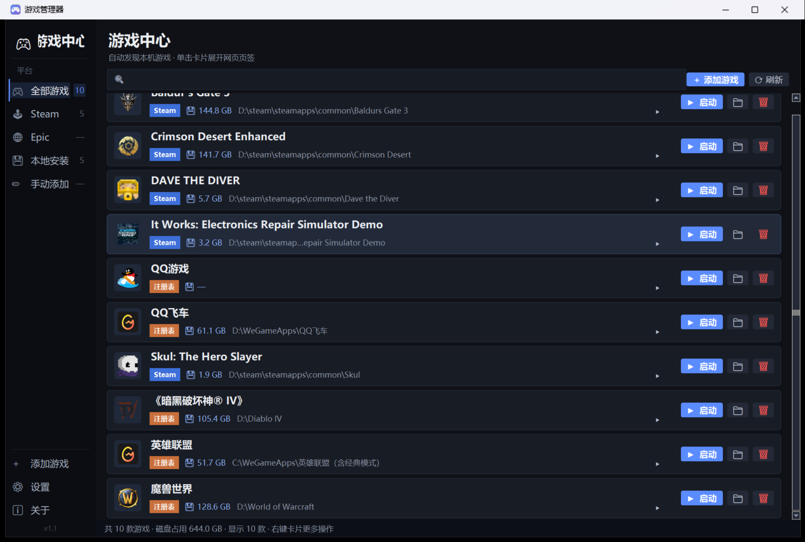

# 🎮 游戏管理器

   

一个本地桌面小工具，自动扫描并管理你电脑里的所有游戏。



> 📌 项目位置：`D:\game_manager`
> 🔧 开发文档：见 [开发记录.md](开发记录.md)（架构、技术决策、踩坑经验、待办事项）

## 环境要求

- Windows 10 / 11
- Python 3.10+（开发环境为 3.14 + tkinter 9.0）
- **零第三方依赖**——全部使用 Python 标准库

## 功能

- **自动扫描**：自动发现 Steam、Epic、注册表（含战网/腾讯/拳头等）中已安装的游戏
- **一键启动**：点击卡片上的「▶ 启动」按钮直接运行游戏
- **🌐 网页页签**（v1.1 新增）：**单击卡片**（或右侧 ▾）展开网页区——自动预置 Steam商店/搜攻略/B站 等安全页签（点击即开），点「＋」可添加任意网站（如攻略站），自动抓取网站小图标，右键可编辑/删除
- **显示游戏图标**：自动从游戏主程序提取真实图标
- **跳转路径**：点「📁」直接在资源管理器中打开并选中游戏主程序（路径详情可从右键菜单「查看路径」查看，支持复制）
- **一键卸载**：点击「🗑」运行游戏的官方卸载程序（带确认提示）
- **手动添加**：扫描不到的游戏（如 WeGame 游戏）可点「＋ 添加游戏」手动添加
- **设置启动路径**：未识别到启动程序的游戏，右键卡片 → 「🔧 设置启动路径」
- **隐藏**：不想显示的条目可右键隐藏，⚙ 菜单中可恢复

## 使用方法

推荐双击桌面上的**「游戏管理器」快捷方式**（直接启动，无任何多余窗口）。

也可以双击 `启动游戏管理器.bat`（会短暂闪过黑色控制台，属正常现象）。

> 修改过的配置（手动添加、隐藏、自定义启动路径）保存在：
> `%APPDATA%\GameManager\config.json`

## 文件说明

| 文件 | 作用 |
|------|------|
| `app.py` | 图形界面主程序（侧边栏 + 圆角卡片 + 扫描进度 + 磁盘占用统计） |
| `scanner.py` | 游戏扫描模块（Steam / Epic / GameUX / 注册表，含去重） |
| `icon_extractor.py` | 从游戏 exe 提取图标（Win32 API，纯 ctypes） |
| `make_icon.py` | 应用图标生成器（SDF 渲染 + ICO 打包，改图标后重跑即可） |
| `icon.ico` | 应用图标（16~256px 六尺寸） |
| `dev_tests/` | 开发期测试 / 诊断脚本 |
| `启动游戏管理器.bat` | 备用启动脚本（推荐用桌面快捷方式） |

## 从源码运行

```bash
python -X utf8 app.py
```

## 常见操作

| 想做的事 | 操作 |
|----------|------|
| 玩游戏 | 双击卡片，或点「▶ 启动」 |
| 看游戏装在哪 | 点「📁」直接跳转过去；右键 → 「查看路径」可复制完整路径 |
| 删游戏 | 点「🗑」，确认后运行官方卸载程序 |
| 列表里有不想要的 | 右键卡片 → 隐藏 |
| 找不到某个游戏 | 点「＋ 添加游戏」，选择游戏主程序 .exe |
